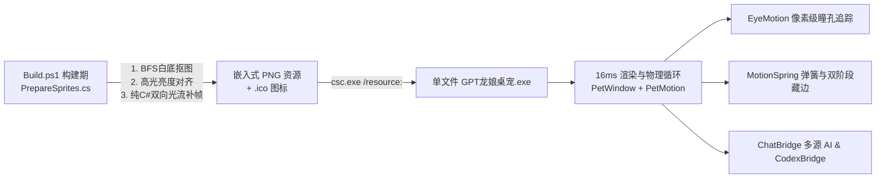

# GPT 龙娘桌宠（GPT Dragon Girl Desktop Pet）v2.5.0

一个 **零外部运行库依赖、单文件绿色运行** 的 Windows 桌面宠物程序。  
它采用 **Windows 系统自带的 .NET Framework 4.x + C# 5.0 + WPF** 纯代码开发，无需安装 Visual Studio 或额外运行库；普通用户双击单个 `GPT龙娘桌宠.exe` 即可把温柔俏皮的「GPT 龙娘」带到桌面上陪伴工作、聊天互动。

---

## ✨ 核心特色

- **开箱即用 · 单文件绿色运行**：全部分层动画帧与图标均在构建期嵌入单个 EXE，无需配置 Python/Node/Codex 环境即可直接使用。
- **大众化多源 AI 大脑**：
  - 内置 5 套在线 OpenAI 兼容预设卡片：**硅基流动 · DeepSeek（新用户免费额度推荐）**、**智谱 AI · GLM-4-Flash（官方免费 API）**、**DeepSeek 官方**、**Google Gemini**、**OpenAI ChatGPT**；
  - 支持一键扫描本机 **Ollama (`11434`)** 与 **LM Studio (`1234`)**，完全离线、免 Key 免费畅聊；
  - 可选 **本机 Codex 免 Key 联动**（未安装 Codex 的电脑会自动隐藏相关开发菜单）以及开发者自定义 Python HTTP 后门。
- **拟真像素级眼神跟随 & 动作情绪联动**：
  - 待机时紫眸瞳孔平滑跟随桌面鼠标位置，会自然随机眨眼、偶发双眨眼与静止微瞥；
  - AI 对话回复可附带 `[mood:wave|curious|celebrate|sleep]` 标签，触发对应动作与星光气泡反馈。
- **双阶段屏幕四边吸附与探头藏边**：
  - 拖拽靠近屏幕四边自动磁吸，静止休息后先滑出屏幕边缘，再无缝切换为圆润的半身探头精灵贴边卖萌。
- **可视化「设置中心」**：卡片式三标签页界面，直观调节体型（小/中/大）、动效开关、开机自启（当前用户注册表）、早午晚时段问候与可选久坐喝水伸懒腰提醒（30 / 45 / 60 分钟）。

---

## 🚀 快速开始

### 普通用户（推荐直接下载 Release）

1. 前往本仓库右侧 [**Releases**](../../releases/latest) 下载 `GPT龙娘桌宠.exe`（约 31 MB 单文件）。
2. 放在任意文件夹中双击运行即可（Windows 10 / 11 原生支持）。
3. 如需开启 AI 对话：双击桌面上的龙娘打开聊天窗口 → 点击顶部 **「选择大脑」** → 选择免费在线 API（如智谱免费 GLM-4-Flash / 硅基流动）填入 Key，或点击 **「扫描本机模型」** 连接本地 Ollama / LM Studio。

### 基础桌面交互

| 操作 | 交互效果 |
| --- | --- |
| **左键轻点头部 / 龙角** | 摸摸头撒娇互动（好奇歪头或伸懒腰 + 专属台词） |
| **左键轻点身体** | 挥手打招呼（随日常次数轮换问候语） |
| **连续点击 3 次** | 触发开心星光庆祝跳跃 |
| **双击龙娘** | 打开「和龙娘聊天」与「选择大脑」窗口 |
| **鼠标在桌上移动 / 停在头部 0.8s** | 瞳孔实时跟随视线；静止悬停约 0.8 秒后好奇歪头（冷却 ≥ 18 秒） |
| **按住左键拖拽并靠近屏幕四边** | 磁吸停靠；闲置后顺滑藏入边线外探出半个小脑袋 |
| **右键点击龙娘** | 打开简洁常用菜单与 **「设置中心」** |

---

## 🛠️ 基于什么开发？（技术栈与工程设计）

本项目刻意避开了重型游戏引擎与臃肿的 Electron 壳，追求 **极低内存占用、原生 DPI 清晰度、零第三方 NuGet 依赖**：

| 维度 | 选型与说明 |
| --- | --- |
| **开发语言与运行时** | **C# 5.0** + **Windows .NET Framework 4.x**（Win10/Win11 系统自带，无需用户额外装 .NET Core / VC++ 运行库） |
| **界面与透明合成** | **WPF（纯 C# 代码建树，无 XAML）**：`AllowsTransparency = true` + `WindowStyle = None` + `Topmost` 实现全透明抗锯齿异形桌宠窗口与纯代码圆角卡片 UI |
| **编译构建工具链** | **Zero-SDK 单命令构建**：`Build.ps1` 直接调用 `%WINDIR%\Microsoft.NET\Framework64\v4.0.30319\csc.exe`，把图像处理生成的全部 PNG 精灵图集与图标通过 `/resource:` 内嵌进单文件 EXE |
| **系统底层互操作** | **Win32 P/Invoke**（`user32.dll` / `gdi32.dll`）：`GetCursorPos`、`MonitorFromPoint`、`SetWindowPos`、`SetWindowRgn` |
| **网络与序列化** | 原生 `HttpWebRequest` + `System.Web.Script.Serialization.JavaScriptSerializer` + `XmlSerializer` |
| **可选 Python 扩展** | Python 3 标准库 `http.server`（`pet_chat_backdoor_demo.py`，零第三方库） |

---

## 🧠 核心实现原理拆解



### 1. 构建期图像处理与纯 C# 双向光流补帧（`PrepareSprites.cs`）
为了让角色图集在不同动作切换时“脚底不漂移、亮度不闪烁、动作更丝滑”，编译阶段会先运行 `PrepareSprites.exe` 做一次性预处理（运行期零开销）：
- **白底泛洪抠图 + 最大连通域去噪**：先采样四角判定白底并执行 BFS 泛洪转透明，再提取最大连通前景清除噪点碎片，并对半透明杂边做色度自适应清理；
- **高光白点与亮度对齐**：以待机图 `idle.png` 为基准，先通过平滑斜坡增益对齐亮部白点（`L >= 180`），保护深色线稿不被洗灰，再微调中间调亮度；
- **1:1 锁脚基准对齐**：按首帧脚底基线与水平中心统一缩放裁切所有动作帧，避免切帧瞬间“人物忽大忽小”；
- **纯 C# 块匹配双向光流补帧**：将相邻关键帧下采样为 1/4 分辨率的 `[亮度, Alpha]` 特征图，搜索前向/后向块匹配位移场并做两次 `3×3` 高斯平滑，随后在预乘 Alpha 空间中按位移矢量双向扭曲融合（`t = 0.5`），把原本 4~9 帧的静态切片自动补全为 `7~17` 帧流畅动画；
- **探头轮廓柔化**：自动剥离探头贴图接触屏幕边缘的硬黑描边，并为左右侧探头底部叠加平滑曲线羽化，使其如发丝自然收拢。

### 2. 实时像素级眼球追踪与拟真眨眼（`PetMotion.cs` → `EyeMotion` & `GazeBehavior`）
不靠生硬的矢量圆片贴图，而是直接操作高精度原画的像素缓冲区：
- 使用 `WriteableBitmap.WritePixels` 仅局部更新左右眼所在的小矩形区域；
- 预计算椭圆径向二次衰减权重矩阵 `Weight = (1 - dx² - dy²)²`：**眼眶与眼白区域权重为 0（完全静止），仅虹膜与高光区域随鼠标方向作双线性插值偏移**；
- 眨眼时按行坐标与 `smoothstep` 曲线生成自上而下的扫掠遮罩，平滑混合睁眼像素与 `blink.png` 闭眼底图，自然支持偶发双眨眼与静止 0.9s 后的视线柔化微瞥。

### 3. 临界阻尼弹簧与双阶段屏幕贴边藏身（`PetMotion.cs` + `PetWindow.Docking.cs`）
- **零过冲弹簧**：`MotionSpring` 使用指数衰减临界阻尼解析解（`Math.Exp(-response * seconds)`），无论帧率怎么波动都不会抖动或过冲；
- **多屏精确互操作**：通过 `MonitorFromPoint` 与 DPI 坐标变换支持多显示器跨屏拖拽（带 15 DIP 跨屏防误触滞回区）；
- **两阶段贴边与硬件裁剪**：贴边闲置后，第 1 阶段（`0~0.64s`）将立绘从屏内顺滑推到工作区边线外；第 2 阶段（`0.64~1.04s`）切换为专用 `PeekTab` 探头精灵从边线探回；同时调用 WPF `layout.Clip` 与 Win32 `SetWindowRgn`，确保藏出屏幕的部分绝对不遮挡任何窗口或拦截鼠标点击。

### 4. 60fps 二次程序化动效与帧间淡化（`PetWindow.cs`）
在逐帧动画之外，渲染循环（16ms 间隔）会叠加：
- **双图层交叉淡出（`fadeOverlay`）**：切换状态或动作帧边界时叠加短暂旧帧淡出，抹平帧切换硬感；
- **二次物理形变**：落地时的弹性挤压回弹（Squash & Stretch）、拖拽时的速度倾斜（`dragTilt`）、呼吸微浮动以及贴边探头时的轻微摇摆。

### 5. 多源 AI 大脑统一桥接与记忆机制（`ChatBridge.cs`）
- 支持 **在线 OpenAI 兼容接口**、**本机 Ollama / LM Studio 自动端口探测**、**本机 Codex** 与 **自定义 Python HTTP 接口** 4 种路由；
- 在系统人设中约定轻量的 `[mood:wave|curious|celebrate|sleep]` 尾标协议，解析后自动从回复文本剔除并同步驱动桌宠做出对应反应；
- 所有配置与最近多轮对话均自动保存至 `%LOCALAPPDATA%\GptDragonPet\`（`settings.xml`、`chat_config.json`、`chat_memory.json`）。

---

## 📁 项目结构说明

| 文件 | 职责说明 |
| --- | --- |
| [`PetWindow.cs`](PetWindow.cs) | 程序入口（`Mutex` 单实例控制）、主透明窗体、60fps 渲染循环与二次动效合成 |
| [`PetWindow.Interaction.cs`](PetWindow.Interaction.cs) | 点击分区互动（摸头/挥手/三连击庆祝）、跨屏拖拽防抖、悬停歪头与喝水提醒 |
| [`PetWindow.Docking.cs`](PetWindow.Docking.cs) | 屏幕四边吸附、双阶段藏边状态机与 Win32 `SetWindowRgn` 裁剪 |
| [`PetWindow.Ui.cs`](PetWindow.Ui.cs) | 系统托盘图标、精简右键菜单、各弹窗管理与 Codex 状态轮询联动 |
| [`PetMotion.cs`](PetMotion.cs) | `EyeMotion` 像素级眼神、`GazeBehavior` 拟真视线、`MotionSpring` 弹簧与 Win32 P/Invoke |
| [`AnimationClips.cs`](AnimationClips.cs) | 动作帧序列时间表与 `EdgePeekTab` 探头边界对齐 |
| [`PrepareSprites.cs`](PrepareSprites.cs) | 构建期白底泛洪抠图、高光亮度对齐、锁脚基准、双向光流补帧与 ICO 生成 |
| [`PetTheme.cs`](PetTheme.cs) | 全应用统一的紫丁香配色、`Freeze()` 画刷与纯代码圆角控件模板 |
| [`PetSettings.cs`](PetSettings.cs) | XML 配置原子存储与 `HKCU\...\Run` 开机自启管理 |
| [`ChatBridge.cs`](ChatBridge.cs) | 多源 AI 对话请求、Ollama/LM Studio 扫描、情绪标签解析与记忆读写 |
| [`ChatPanel.cs`](ChatPanel.cs) | 聊天对话与卡片式「选择大脑」窗口 |
| [`SettingsPanel.cs`](SettingsPanel.cs) | 三标签页可视化「设置中心」窗口 |
| [`CodexBridge.cs`](CodexBridge.cs) / [`CodexPanel.cs`](CodexPanel.cs) | 可选的本机 Codex CLI JSON-RPC / 会话日志联动与面板 |
| [`Build.ps1`](Build.ps1) / [`Check.ps1`](Check.ps1) / [`PetChecks.cs`](PetChecks.cs) | 零依赖单文件编译脚本与 90+ 项自动化集成回归校验 |
| [`pet_chat_backdoor_demo.py`](pet_chat_backdoor_demo.py) | 零依赖 Python 本地 HTTP Agent 接入示例 |
| `SourceSheet.png` / `*Sheet*` | 原始角色精灵图集（详见 [图像生成提示词.txt](图像生成提示词.txt)） |

---

## 🔨 本地编译与自动化校验

只需任意 Windows 10 / 11 自带 PowerShell（无需安装 Visual Studio）：

```powershell
# 1. 处理图集并一键编译为单文件 EXE（输出到 .\dist 目录）
powershell -ExecutionPolicy Bypass -File .\Build.ps1 -OutputDirectory .\dist

# 2. 运行全量自动化校验（需先执行一次 Build.ps1 生成 sprites 缓存）
powershell -ExecutionPolicy Bypass -File .\Check.ps1
```

---

## 🧩 开发者扩展：接入自己的 Python Agent / MCP / 工作流

1. 运行附带的零依赖示例服务：
   ```bash
   python pet_chat_backdoor_demo.py
   ```
2. 在桌宠聊天窗口 → **「选择大脑」** → 展开底部的 **「开发者与高级选项」** → 选择「本地 HTTP 后门」，地址填 `http://127.0.0.1:8765/chat`。
3. 协议约定为简单的 JSON `POST /chat`：
   - 请求体：`{"message": "...", "persona": "...", "history": [...]}`
   - 响应体：`{"reply": "你好呀！", "mood": "wave"}`（`mood` 可选 `normal` / `wave` / `curious` / `celebrate` / `sleep`）

---

## 🙏 版权声明与致谢

- 本项目为基于画师同人设定的 **非官方开源桌面宠物二创项目**，与 OpenAI 官方无隶属关系。
- **角色形象与同人设定**：致谢画师 **ZipZipPipe** 创作的 GPT 龙娘形象（Pixiv `148186519`、Bilibili `BV1tE9XBbErS`）及相关开源同人参考图收集项目 `ai-girls`。
- **技术思路致谢**：
  - 像素级眼球追踪与拟真视线物理设计思路灵感参考自 [blessonism/grok-icon-study](https://github.com/blessonism/grok-icon-study)；
  - 桌面宠物四边吸附、探头藏边与互动体验灵感参考自 [jingh12312-rgb/bailong-desktop-pet](https://github.com/jingh12312-rgb/bailong-desktop-pet)。
- 更多使用细节与版本演进记录请参见 [使用说明.md](使用说明.md) 与 [更新日志.md](更新日志.md)。
